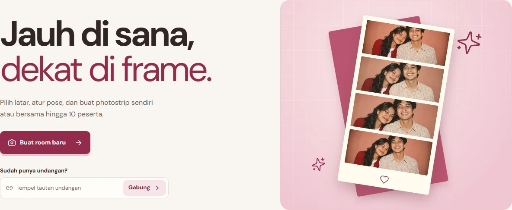
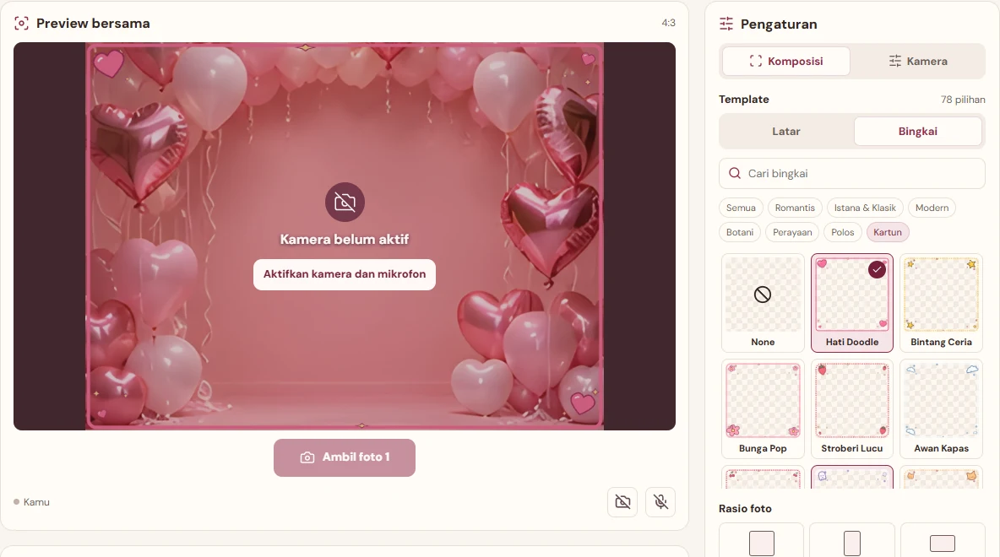

# PhotoboxWeb

**Studio photobooth di browser untuk foto solo atau bareng hingga 10 peserta.**

[Mulai lokal](#mulai-lokal) · [Cara pakai](#cara-pakai) · [Arsitektur](#arsitektur) · [Pengujian](#pengujian) · [Deployment VPS](#deployment-vps)

## Cara pakai

1. Buat room atau buka tautan undangan. Aktifkan kamera dan mikrofon sesuai kebutuhan.
2. Pilih latar, bingkai, dan rasio. Geser, ubah ukuran, atau atur urutan layer kamera di preview bersama.
3. Pilih slot lalu tekan **Ambil foto** di bawah preview. Ikon mata membuka foto satu per satu. Slot yang terisi dapat dihapus atau difoto ulang.
4. Buka **Pratinjau & edit** untuk menambah teks, mengganti atau menghapus watermark, dan menyimpan hasil. Album privat menyediakan photostrip serta foto individual selama satu jam per versi.

| Fitur | Pilihan |
| --- | --- |
| Room | 1–10 peserta, preview bersama dan obrolan audio |
| Kamera | Penghapus latar langsung, mirror dan kontrol warna |
| Koleksi | 80 latar, 78 bingkai, tanpa bingkai, dan latar unggahan |
| Rasio foto | 1:1, 2:3, 3:2, 3:4, 4:3, 4:5, 5:4, 9:16, 16:9 |
| Photostrip | 1×2, 2×1, 4×1, 2×2, 2×3, 3×2, 2×4, 4×2 |
| Editor | Layer teks dengan font, ukuran, warna, perataan, posisi, dan rotasi |

Lihat preview studio dan pemilih template

## Mulai lokal

Butuh Node.js 22.13+ dan npm. Jalankan dari terminal, termasuk Windows CMD.

~~~sh
git clone https://github.com/DapuntaRatya/PhotoboxWeb.git
cd PhotoboxWeb
npm ci
npm run dev
~~~

Buka [http://127.0.0.1:5173](http://127.0.0.1:5173). Untuk menguji dua peserta pada komputer yang sama, buka undangan di profil browser kedua atau jendela privat.

Jalankan di jaringan lokal dengan HTTPS

1. Siapkan sertifikat HTTPS dengan SAN yang mencantumkan IPv4 host. Simpan sertifikat di `data/lan/server.crt` dan kunci di `data/lan/server.key`.
2. Jika memakai CA lokal, percayai sertifikat publik CA tersebut pada perangkat uji.
3. Jalankan `npm run dev:lan`, lalu buka `https://<IPv4-host>:5173` di semua perangkat. Gunakan alamat itu saat membuat room agar tautan undangan dapat dibuka dari perangkat lain.

## Arsitektur

~~~mermaid
flowchart LR
    A["Browser peserta A"] <-->|"WebRTC · media dan foto draft"| B["Browser peserta B"]
    A <-->|"HTTPS dan WebSocket"| N["Nginx · TLS dan frontend"]
    B <-->|"HTTPS dan WebSocket"| N
    N <-->|"/photobox/api dan /photobox/ws"| S["Node.js · room dan album"]
    S --> D[("SQLite · metadata")]
    S --> F["Disk privat · JPEG ekspor"]
~~~

Pemrosesan kamera dan komposisi berjalan di browser. Draft foto disimpan di IndexedDB dan dapat dipulihkan dari peserta yang masih terhubung. Nginx menyajikan frontend, sedangkan Node.js mengelola signaling, room, dan album.

Model kamera dan aset

- Browser dengan WebGPU dan `shader-f16` memakai Longpipe Large. Perangkat lain memakai MediaPipe Selfie Segmenter dan Hand Landmarker. [Longpipe](https://longpipe.dev/docs/model-layer/) · [MediaPipe Image Segmenter](https://developers.google.com/edge/mediapipe/solutions/vision/image_segmenter/web_js)
- Aset raster ekspor memakai sumber 3840 × 3840 yang ditingkatkan resolusinya. Preview dan kartu template memakai versi lebih kecil. [Real-ESRGAN](https://github.com/xinntao/Real-ESRGAN)
- Lisensi model dan SDK Longpipe tersedia di [public/vision/longpipe](public/vision/longpipe). Foto contoh dan sebagian aset template dibuat dengan ImageGen.

## Pengujian

| Perintah | Cakupan |
| --- | --- |
| `npm run build` | TypeScript dan build frontend produksi |
| `npm test` | Room, layout, capture, ekspor, retensi album, dan restart API |
| `npm run test:browser` | Alur foto solo dan tiga peserta, retake, hapus, editor, dan album |
| `npm run test:templates` | Sinkronisasi setiap latar dan bingkai, termasuk pemuatan ulang aset |

Tes browser memakai Chrome dan memerlukan server yang berjalan. Atur `PHOTOBOX_TEST_URL` untuk mengganti alamat uji atau `PHOTOBOX_TEST_BROWSER` ke `msedge` untuk memakai Edge.

## Deployment VPS

Nginx melayani HTTPS dan merutekan proyek berdasarkan path. PhotoboxWeb berada di `/photobox/`. Root dan rute yang belum terdaftar mengembalikan 404. [Panduan instalasi, update Git, dan penambahan proyek](deploy/README.md)

Made with ♥ by Dapunta & Sol 6.1

